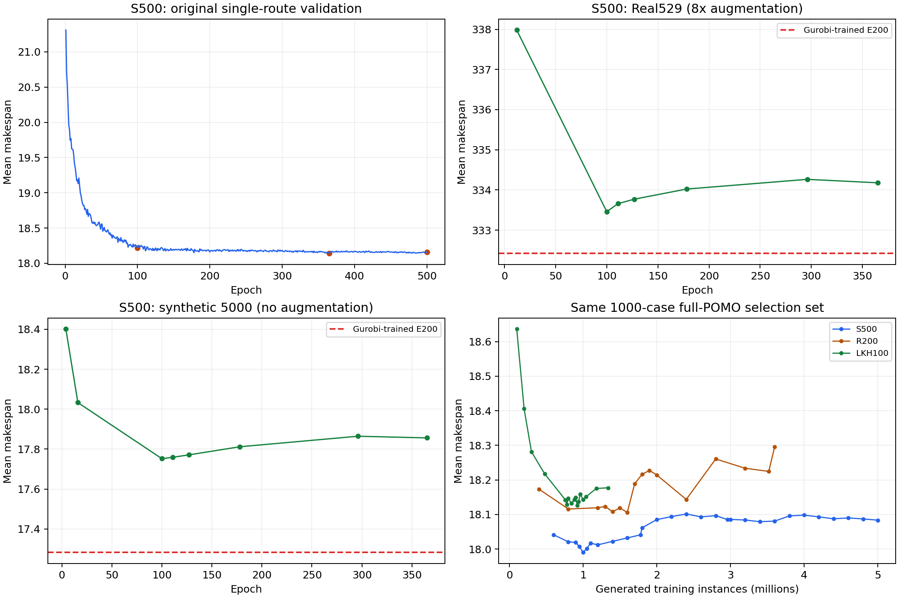
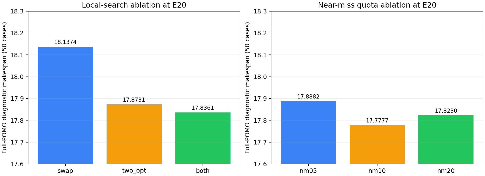

# CVTSP 实验完整复盘：从500个epoch训练到LKH＋near-miss20%

**证据截点：2026-10-15T15:57:55+08:00（UTC+8）。**

本报告覆盖旧版500轮训练、历次外部测试与独立回测、奖励选路诊断、短程IL/学习率控制实验、200轮重训、会议后的局部搜索/near-miss/IL标签实验，以及目前的LKH100轮训练。内容依据当前项目中保存的参数、指标CSV、逐例结果JSON、完成审计、源码与会议纪要整理；对话中的近似数值不覆盖已核实的原始结果。

报告只汇总已有实验，不改变训练、Reference更新规则或选模程序。当前训练数据是动态产生的，本报告保留读取时的指标快照；后续epoch不在此截点内。文中的“最好”均限定于相应训练和已评测的checkpoint集合。

**数值约定：**makespan越低越好；除特别注明，`gap=(本方法均值/基线均值−1)×100%`，正值表示本方法更差。不同数据集、不同解码协议的绝对均值不能直接比较。95%区间若来自实例配对bootstrap，只说明这些实例上的差异，不包含不同训练seed的不确定性。

## 1. 当前能够确认的结论

1. 旧版S500的固定验证最优在Epoch365（18.139799），但目前已完成的外部测试中Epoch100更好：Real529为333.459454，人工5000为17.751879。固定验证和最终测试确实存在排序背离。
2. 独立完整POMO选模集在旧版已回测29个checkpoint中选出Epoch100，说明改评测方式有用；这并不解释或消除训练本身的退步。
3. 旧版E100→E365的训练式采样诊断中，上界选路regret反而下降，完整POMO精确最优基本不变。不能把后期退步归因于“上界排序越来越差”。
4. 从E100继续20轮，IL5→2或加快LR衰减均未超过E100；相对原E120的改善区间均跨零，尚无明确获益证据。
5. 三组从头20轮局部搜索实验中，swap-only明显落后；2-opt-only在单路线固定验证更好，swap＋2-opt在独立完整POMO50例中均值最好。不能只报一个有利指标。
6. near-miss20%增加了精算覆盖和改进Expert比例，并改善前20轮单路线固定验证；独立完整POMO50例的均值最好是10%组。没有证据证明20%是最终最优比例。
7. LKH在冻结策略、相同输入的100例搜索实验中改善了Expert平均质量；此证据只覆盖搜索阶段，不能等同于从头训练和泛化提升。
8. 当前LKH训练重新选模后，E46的外部表现优于旧验证选出的E59，但仍不及旧版S500-E100，更未超过Gurobi训练基线E200。
9. 每epoch实例数从1万改到2万，改变了优化节奏：同样100万实例，RL更新数接近，IL更新数从40,510降至21,165，学习率也更低。“IL都是5遍”不足以说明训练强度对齐。
10. 质量加权IL的B组只完成6轮，第7轮中途停止；不具备20轮终点结论。后续LKH训练没有启用质量加权IL。

## 2. 训练与实验代号：避免混淆同名Epoch

| 代号 | 对应实验 | 计划与实际 | 主要用途 |
| --- | --- | --- | --- |
| G200 | POMO＋Gurobi训练基线的Epoch200 | 200×100,000≈2000万训练实例 | 共同外部基线；不是纯Gurobi全局TSP最优解 |
| S500 | 旧版向量化、质量受限多样性＋密集POMO训练 | 500×10,000＝500万，已完成 | 历史主实验，E100为已测外部最好 |
| E100-IL2 / LR150 | 从S500-E100继续的两个控制分支 | E101–120，各20轮 | 只解释旧模型后期训练，不是从头终点成绩 |
| R200 | 2万实例、IL5/2/1、replay10%、TopK随J增加 | 200×20,000＝400万，已完成 | 另一次从头重训；不要把其E176当成S500-E178 |
| LS-A/B/C | swap-only / 2-opt-only / swap＋2-opt | 各20×20,000＝40万，均已完成 | 只改变搜索算子，move按100轮30→10 |
| NM05/10/20 | 固定near-miss配额5%/10%/20% | 各20×20,000＝40万，均已完成 | 固定30move，组间只改变配额 |
| QIL-B | 按Expert相对Target真实质量加权CE | 计划20轮，实际完成6轮，第7轮中止 | 未完成实验；不能认定加权普遍有效或无效 |
| LKH-pilot | 冻结NM20-E20策略的LKH搜索对照 | 100例，无网络训练 | 验证搜索适配与Expert质量 |
| LKH100 | LKH＋near-miss20%的当前从头训练 | 计划100×20,000；截点完成81轮 | 本轮旧验证best E59，已测选模best E46 |

### 2.1 时间线

| 记录日期 | 实验/工作 | 结果状态 |
| --- | --- | --- |
| 2026-09-17至09-23 | S500向量化主训练及多次外部测试 | 500轮完成；E100后外部测试未同步改善 |
| 2026-09-21起 | 建立独立1000例完整POMO选模集并回测 | S500共29个checkpoint完成回测 |
| 2026-09-22 | E100/E365奖励选路诊断；IL2/LR150控制分支；sample测试 | 结果均已落盘 |
| 2026-09-23至09-30 | R200从头重训、硬件/worker异常排查及压力测试 | 9月28日压力测试退出0；正式200轮最终退出0 |
| 2026-09-30 | R200独立选模 | 在16个已测checkpoint中选E80，仍不及S500-E100 |
| 2026-10-10 | 整理旧日志，准备2000验证＋500测试，恢复E500参数分支 | 准备动作，不冒充新增完整训练结果 |
| 2026-10-12至10-13 | 三组局部搜索从头20轮及过程诊断 | 全部完成并通过完成审计 |
| 2026-10-13至10-14 | 三组near-miss配额从头20轮 | 全部完成并通过完成审计 |
| 2026-10-14 | 质量加权IL-B、LKH100例pilot、启动LKH100 | B提前停止；pilot完成；LKH从随机初始化开始 |
| 2026-10-15 | LKH-E59/E46外部测试与独立选模 | 两套外部集均完成；LKH100训练尚未结束 |

## 3. 核心算法：哪些模块一直保留，哪些后来改变

证据索引：S01、S11、S19（原文件见附录E）。

### 3.1 每个训练epoch的整体流程

1. 随机生成新的CVTSP训练实例，J在20–100范围随机抽取；同batch采用同一J。Reference为每例采样200条候选。
2. Edge Predictor给候选的有向边代价打分，选Anchor；固定Anchor访问顺序，用Gurobi精算连续位置和时间。
3. 由Anchor的可行连续解构造有向严格上界表C0。它给定路线一个可实现的上界，不能当成该路线优化后的精确makespan。
4. 按C0选Top-K：通常固定30，质量部分20，多样性部分最多10；多样性候选同时受前60和相对质量门槛5%约束。合格多样性不足时质量补齐，因此实际并非每例恰好20＋10。
5. 以这些路线为起点，在固定C0上搜索。S500及大部分消融用swap/2-opt；LKH100改用LKH。中间不调用Gurobi。
6. 候选上界严格优于Anchor时精算验证；未通过严格改善门槛但仍有不同路线的实例，可按near-miss配额额外精算一个候选。只有精确makespan严格改善才替换Anchor成为改进Expert，否则保留Anchor标签。
7. Target生成POMO路线。Anchor/Expert分别给出完整路线的严格上界，先求各自整条路线总和，再在完整上界之间取小；不能逐边取小拼接。
8. 选一条上界最低的Target路线做Gurobi精算，其余POMO路线用上界，进行RL。整个epoch的RL结束后，再汇总标签做IL和Edge Predictor更新；改进Expert进入历史池。它不是每个batch完成一次完整RL→IL交替。
9. 每轮按固定验证比较Target和Reference，严格更好时更新Reference；保存checkpoint、优化器、scheduler、Reference、Predictor、replay和RNG。

### 3.2 RL、IL和Replay的准确含义

密集POMO主奖励使用一条精确Target值和其余路线的严格上界，每个实例内部对优势中心化并标准化，让全部POMO路线参与梯度。精确辅助项比较那条被精算Target与Expert：

$$A_E=\operatorname{clip}\left(\frac{V_E-V_T}{\max(|V_E|,10^{-12})},-1,1\right),\qquad
L_{RL}=L_{POMO}+\lambda_E L_{exact}.$$

`λE`按预先定义的训练能力指标增加到1，不由外部测试决定。密集奖励仍混合了上界与精确值，因此不是“J条Target全部精算”的RL。

常规IL采用Expert访问序列的teacher-forcing交叉熵，固定5遍。改进Expert的权重5在实现上为重复5份；保留Anchor的标签为1份。Replay通常占扩充后IL样本的30%，只存历史真实改进Expert，容量50,000；达到容量后按现有淘汰规则更新，不是停止产生新Expert。固定容量本身不能证明平台的原因。

**Expert比例、Expert真实改善、IL准确率、POMO最好路线质量是不同指标。**新Expert多不等于标签一定适合当前Target；token准确率高不等于整条路线或完整POMO的最优makespan持续下降。

### 3.3 旧版Epoch100之前已存在的主要算法变化

- 从不受质量约束的“差异最大10条”改为有质量门槛的多样性：仍探索不同访问结构，但避免非常差的路线仅凭差异进入Top-K。
- 恢复密集、标准化POMO主奖励，加入有界精确Expert辅助，缓解只比较一条Target与Expert时的冷启动信号问题。
- near-miss按训练能力从1%到5%变化，改进Expert权重5、IL5遍、replay30%。
- 局部搜索改成结果等价的向量化swap/2-opt，保留候选、接受条件和tie-breaking。

**不能算入旧E100的后续变化：**固定near-miss20%、LKH、质量加权IL、2万实例/轮、100轮到1e-5的LR计划，以及R200的IL5/2/1、replay10%、自适应Top-K。旧S500没有完整源文件快照，后来的“恢复E500逻辑”依据保留参数和现有实现分支，不等于逐字节回退到旧代码。

### 3.4 向量化属于哪一类变化

原swap/2-opt逐候选在Python中计算，向量化实现把同一路线的候选代价变化集中到数组计算，并缓存每种J的候选索引，减少函数调用、tuple创建和解释器循环。其设计目标是保持候选集合、接受条件、tie-breaking和最终路线一致，属于工程加速；不能把速度变化当作一次新的算法质量提升。原S500启动脚本明确启用`CVTSP_VECTORIZED_LOCAL_SEARCH=1`。本报告未重新运行训练或声称复验全部历史等价性测试；当前LKH是另一种搜索算法，不能用“向量化等价”说明LKH与原算法等价。

## 4. 数据集与评测协议：哪些数字可以放在同一张表

证据索引：S03、S20、S21（原文件见附录E）。

| 集合 | 数量与J | 解码与精算 | 用途 |
| --- | --- | --- | --- |
| 旧固定验证 macsim_fixed | 1000；5种J各200 | 单条free-start greedy，Gurobi精算 | S500/R200的Reference更新与best |
| 新固定验证 validation2000 | 2000；5种J各400 | 仍为单条free-start greedy，Gurobi精算 | 局部搜索、配额、B组、LKH训练在线验证 |
| 独立完整POMO选模集 | 1000；5种J各200；seed20260921 | greedy，POMO=J，无增强，精算所有不同候选取最优 | 跨checkpoint回测及选模；是开发集 |
| 新独立诊断集 | 100；5种J各20；seed20261012 | 单路线；其中预先固定50例做完整POMO | 阶段/梯度/搜索诊断，不是最终测试 |
| 新人工test500 | 500；5种J各100；seed20262010 | 完整POMO，无增强，Gurobi精算 | 已准备；本报告未找到正式完整测试结果 |
| 旧人工synthetic5000 | 5000；5种J各1000；seed20260827 | greedy，POMO=J，无增强，Gurobi精算 | 一直保留的外部评测集 |
| Real529全体 | 529，J10至200共19种规模 | greedy，POMO=min(J,100)，8倍几何增强，Gurobi精算 | 外部真实实例评测 |
| Real529训练规模子集 | 284；J=20/25/30/35/40/45/50/100 | 与全529采用同一评测结果筛子集 | 范围内分析；不能替代全529 |

新验证/测试已对已保存的旧固定集、完整POMO开发集和人工5000等做精确内容查重。历史全部随机训练实例未保存，因此只能说明独立RNG和对已保存集合无重复，不能声称已逐条证明与所有历史训练数据不重叠。

完整POMO选模的分数为“每例先在候选间取最小，再对实例取平均”，不是把全部路线makespan直接平均。它与人工5000的核心评测方式一致；Real529额外有8倍增强、J>100时POMO上限100，不能说三者完全同协议。

G200与Self-improving测试时最终都用Gurobi精算固定访问顺序。比较的是训练后的上层策略，不是“Gurobi求解器对LKH求解器”。LKH100的这些外部测试**没有在测试时额外运行LKH**。

### 4.1 Gurobi训练基线的实际配置

G200来源为`outputs/train__cvtsp_random_n100_nearest_quarter/checkpoint-200.pt`。保存参数：每轮100,000实例、batch512、学习率5e-5、seed1234，网络embedding128、encoder6层、8头；Self-improving参数为embedding256、encoder4层、16头、dropout0.1。G200在E200名义累计约2000万实例，S500-E100约100万。它是既有实验基线，不是训练数据预算和网络架构完全相同的单变量对照；不能把相近测试成绩单独归因于某一个模块。

## 5. S500：500轮旧主实验的训练轨迹

证据索引：S01–S04（原文件见附录E）。

### 5.1 实际配置与完成状态

| 项目 | S500配置 |
| --- | --- |
| 总轮数 / 每轮实例 / 总实例 | 500 / 10,000 / 5,000,000 |
| J / batch / POMO | 20–100 / 64 / J |
| 学习率 | 1e-4→1e-7；按epoch的余弦，warmup1轮 |
| Reference候选 / Top-K | 200 / 固定30（质量20＋质量受限多样性最多10） |
| 局部搜索 | 向量化swap＋2-opt，每起点最多30接受move |
| near-miss | 按训练能力在1%–5%范围变化；ceil配额使实际比例可能更高 |
| IL / changed权重 | 5遍 / 5 |
| Replay | 容量50,000，实际IL占比约30% |
| 验证 | 旧1000例，单greedy，每轮 |
| 实际完成 | metrics.csv共500行，最后一轮E500，保存主优化器累计281,015步 |

### 5.2 分阶段汇总

| 轮次 | 固定验证起→止 | Expert平均真实改善 | 改进Expert比例 | IL token准确率 | 平均move/起点 |
| --- | --- | --- | --- | --- | --- |
| 1–20 | 21.3098→19.0989 | 3.618% | 17.60% | 61.82% | 20.03 |
| 21–100 | 18.9970→18.2189 | 0.439% | 10.47% | 80.85% | 14.97 |
| 101–200 | 18.2336→18.1600 | 0.403% | 10.18% | 88.56% | 10.01 |
| 201–365 | 18.1772→18.1398 | 0.172% | 7.56% | 90.80% | 8.41 |
| 366–500 | 18.1621→18.1564 | 0.080% | 6.08% | 92.37% | 6.53 |

这些Expert改善百分比是逐实例相对Anchor改善的汇总，不能直接用两个训练makespan均值相除替代。训练实例的J和难度每轮变化，训练makespan不是固定评测曲线。

### 5.3 关键epoch的固定验证与外部结果

| Epoch | 累计实例 | 旧固定验证 | Real529 | Real284 | 人工5000 |
| --- | --- | --- | --- | --- | --- |
| 4 | 0.04百万 | 20.244454 | 待补充 | 待补充 | 18.400926 |
| 12 | 0.12百万 | 19.519842 | 337.981044 | 362.898806 | 待补充 |
| 16 | 0.16百万 | 19.169462 | 待补充 | 待补充 | 18.032759 |
| 100 | 1.00百万 | 18.218866 | 333.459454 | 358.793666 | 17.751879 |
| 111 | 1.11百万 | 18.176343 | 333.657882 | 359.449986 | 17.758839 |
| 127 | 1.27百万 | 18.177242 | 333.771171 | 359.320835 | 17.770940 |
| 178 | 1.78百万 | 18.149309 | 334.022038 | 360.011506 | 17.811545 |
| 296 | 2.96百万 | 18.173483 | 334.263660 | 360.309539 | 17.864227 |
| 365 | 3.65百万 | 18.139799 | 334.177603 | 360.107148 | 17.855958 |
| 500 | 5.00百万 | 18.156394 | 待补充 | 待补充 | 待补充 |

“待补充”表示没有找到该checkpoint对应的已完成测试，不能由相邻epoch插值。S500-E500完成训练，不代表E500完成外部测试。

E100固定验证18.218866，E365降到18.139799，改善约0.434%；E500为18.156394。与此同时E100→E365，Real529上升0.718149，人工5000上升0.104079。报告中的原始逐例配对区间分别为[+0.387246,+1.039872]和[+0.092016,+0.116680]，支持在这些固定外部实例上E365退步，并不是只差一个随机小数。

图中不同集合使用不同子图；右下才是同一完整POMO选模集上的跨训练比较，横轴换算为累计新训练实例。连线只连接已经评测的checkpoint，不代表其间每轮都测试。

### 5.4 E100与G200的差距

| 集合 | G200 | S500-E100 | gap | E100胜/平/负 |
| --- | --- | --- | --- | --- |
| real529 | 332.420655 | 333.459454 | 0.312% | 121/142/266 |
| real529_J20_100 | 357.318427 | 358.793666 | 0.413% | 78/26/180 |
| synthetic5000 | 17.282643 | 17.751879 | 2.715% | 609/117/4274 |

### 5.5 解释边界

- 这500轮证实：同一配方继续训练，旧单路线验证可以改善，而完整POMO外部表现没有持续改善。
- 它不证明E100以后所有训练计算都毫无作用：上界选路、单路线质量、IL准确率等确实变化；问题是这些变化没有转化成目标测试表现。
- 固定验证集未参加梯度更新，但用于Reference晋升，因而会间接改变后续训练。存在开发集选择反馈，但仅凭验证/测试背离不能把原因确定为过拟合。
- “验证集固定”本身不是错误；单路线验证与最终多路线取最优的目标不一致，是已确认的评测差异。

### 5.6 旧训练保存的时间数据

| 轮次 | 平均训练字段/分钟 | 平均固定验证/分钟 |
| --- | --- | --- |
| 1–20 | 9.05 | 2.15 |
| 21–100 | 8.30 | 2.15 |
| 101–200 | 7.48 | 2.15 |
| 201–365 | 7.03 | 2.15 |
| 366–500 | 6.56 | 2.16 |

时间来源为旧metrics及其分阶段汇总，训练字段与验证字段分列；这不是含暂停、checkpoint保存、所有资源等待的整段自然日时间。三组并行实验中的“每轮完整墙钟”另有定义，不能把不同口径的分钟数直接解释成某算法慢了几倍。会议提到的“近七倍提速”在本报告中不作为已完成同机严控benchmark结论。

## 6. 独立完整POMO回测：验证选模方式

证据索引：S05（原文件见附录E）。

使用seed20260921新建的1000例固定开发集，J20/40/60/80/100各200。每例完整POMO，greedy、无增强、Gurobi精算所有不同候选。已回测的29个S500 checkpoint中，E100均值最低。

| Epoch | 完整POMO选模makespan | 相对E100的均值差 |
| --- | --- | --- |
| 60 | 18.041239 | 0.050920 |
| 80 | 18.020759 | 0.030440 |
| 90 | 18.019107 | 0.028788 |
| 95 | 18.007079 | 0.016760 |
| 100 | 17.990319 | 0.000000 |
| 105 | 18.001024 | 0.010704 |
| 110 | 18.016955 | 0.026635 |
| 120 | 18.012122 | 0.021803 |
| 140 | 18.022162 | 0.031843 |
| 160 | 18.032042 | 0.041722 |
| 178 | 18.040999 | 0.050680 |
| 180 | 18.061302 | 0.070983 |
| 200 | 18.085009 | 0.094690 |
| 220 | 18.093801 | 0.103482 |
| 240 | 18.101324 | 0.111005 |
| 260 | 18.092993 | 0.102673 |
| 280 | 18.096626 | 0.106307 |
| 296 | 18.085154 | 0.094835 |
| 300 | 18.085666 | 0.095347 |
| 320 | 18.083860 | 0.093540 |
| 340 | 18.079078 | 0.088759 |
| 360 | 18.080753 | 0.090434 |
| 380 | 18.095743 | 0.105423 |
| 400 | 18.098067 | 0.107748 |
| 420 | 18.093022 | 0.102703 |
| 440 | 18.087384 | 0.097065 |
| 460 | 18.089892 | 0.099573 |
| 480 | 18.087073 | 0.096754 |
| 500 | 18.083433 | 0.093114 |

可核实的代表结果：E100=17.990319；E365并未列入这29个回测点，邻近E360=18.080753；E500=18.083433。不要把E360的选模分数冒充E365的分数。

**结论：**这套评测能在历史候选中选到外部测试也较好的E100。但它已经反复用于开发判断，属于开发验证，不再是未接触的独立测试集；亦不能声称“在全部500个checkpoint中已经穷尽证明E100最好”。

## 7. 诊断一：是否因为Target上界选错路线而退步

证据索引：S06（原文件见附录E）。

### 7.1 实验设置

200个新固定实例，五种J各40，seed20260922；同实例分别恢复S500-E100和E365的Reference/Predictor/上界流程。按训练sample模式生成Target POMO，上界最低者为训练规则选中路线；再把本次全部Target候选都Gurobi精算，得到“本次候选中的精确最优”。这不是全局CVTSP最优，也不是greedy外部评测。

| 指标 | E100 | E365 | E365−E100的95%区间 |
| --- | --- | --- | --- |
| 上界选中路线的精确值 | 18.529323 | 18.406458 | [-0.238896, -0.009869] |
| 全部POMO中的精确最好 | 17.925014 | 17.923651 | [-0.053762, +0.050617] |
| 选择regret＝选中−最好 | 0.604309 | 0.482806 | [-0.237174, -0.010105] |
| 恰好选中精确最好的比例 | 16.5% | 17.5% | 原报告未给比例区间 |
| 所有POMO路线的平均上界松弛 | 13.503542 | 7.949639 | [-6.116649, -4.990178] |

**结论：**上界选择仍有误差，但E365的选择regret更低，并非越来越差；这份诊断不支持“后期退步由上界误排序恶化导致”。采样候选中的真实最好值基本没进步，更值得检查路线分布、RL/IL学习过程与测试目标。

## 8. 诊断二：sample解码、不做8倍增强

证据索引：S07（原文件见附录E）。

两模型每例各做一次随机POMO rollout，逐例重置为相同seed；精算全部不同候选取最优。相同seed不能保证不同模型采到同一路线，作用是对齐随机输入。此结果是单seed的sample协议，不与greedy/8倍增强成绩混成一列。

| 集合 | G200 sample | S500-E365 sample | E365−G200 | 95%区间 | 胜/平/负 |
| --- | --- | --- | --- | --- | --- |
| Real529 | 337.147721 | 341.616630 | 4.468909 | [+3.692672, +5.221229] | 132/50/347 |
| Real284 | 363.164126 | 369.293923 | 6.129796 | [+4.931765, +7.341196] | 77/2/205 |
| 人工5000 | 17.276256 | 17.839756 | 0.563500 | [+0.550342, +0.577277] | 420/72/4508 |

**结论：**切换sample并未让E365超过G200；不能据此认为只要改测试解码就能消除差距，也不能凭单seed确定sample永远更差。

## 9. 从E100继续的IL与学习率控制实验

证据索引：S08（原文件见附录E）。

### 9.1 设计

均从同一个S500-E100恢复参数、optimizer、Reference、Edge、replay50,000和RNG，只观察E101–120。IL2分支把5遍改为2遍；LR150分支将余弦继续轨迹锚定在E100实际优化器LR约9.0571e-5，计划到E150降至1e-7。S500原E120作为已有对照；测试用相同1000例完整POMO开发集。

| 模型 | 选模makespan | 相对E100改善 | 95%区间 | 相对原E120改善 |
| --- | --- | --- | --- | --- |
| E100 | 17.990319 | — | — | — |
| 原E120 | 18.012122 | -0.021803 | [-0.043141, -0.001334] | — |
| IL2-E120 | 18.006555 | -0.016236 | [-0.035705, +0.002651] | 0.005567 |
| LR150-E120 | 18.001088 | -0.010769 | [-0.030481, +0.008582] | 0.011034 |

此表“改善”为E100或原E120减分支，正值更好，与全报告默认gap符号不同。IL2与LR150相对原E120的区间分别为[-0.010420,+0.021529]、[-0.005049,+0.028237]，均跨零。

**结论：**两个改动的点估计都略好于原E120，但未超过E100，也未提供相对原E120的清晰改善证据。这只能限制“旧E100后的20轮续训”解释，不能推导从头训练必然失败；也不能作为最终重训成绩。

## 10. R200：2万实例＋IL5/2/1＋replay10%＋随J增加Top-K

证据索引：S09、S10、S23（原文件见附录E）。

### 10.1 与S500同时改变的因素

- 总轮数200，每轮20,000，总400万新实例；学习率1e-4→1e-7，200轮余弦。
- IL预先固定为E1–50五遍、E51–100两遍、E101–200一遍。
- Replay30%/50,000改为10%/20,000。
- Top-K从固定30改为`max(30,ceil(0.5J))`，J80时40，J100时50，保留最多10条质量受限多样性起点。
- 保留密集POMO＋有界精确Expert辅助、swap/2-opt30步、adaptive near-miss1%–5%、旧单路线验证。

这是多项共同变化的从头训练，不能用它单独断言IL、Replay或Top-K各自的效果。

### 10.2 实际训练与选模

R200已完整训练200轮，最终TRAIN_EXIT=0（2026-09-30 14:49:33 UTC+8）。旧固定验证best为E176=18.534560；E200为18.683525，末轮IL为1遍，累计主优化器99,497步。

同一1000例完整POMO开发集回测16个checkpoint，选出E80=18.105771；旧S500-E100在同集合为17.990319，R200选模最好仍落后0.115452。

| R200 Epoch | 完整POMO选模makespan |
| --- | --- |
| 20 | 18.173456 |
| 40 | 18.115771 |
| 60 | 18.119313 |
| 65 | 18.123131 |
| 70 | 18.107881 |
| 75 | 18.118833 |
| 80 | 18.105771 |
| 85 | 18.188567 |
| 90 | 18.215862 |
| 95 | 18.227288 |
| 100 | 18.214245 |
| 120 | 18.143432 |
| 140 | 18.260499 |
| 160 | 18.233620 |
| 176 | 18.224500 |
| 180 | 18.295811 |

### 10.3 外部测试

| 模型/集合 | makespan | G200 | gap | 完成情况 |
| --- | --- | --- | --- | --- |
| R200-E11 / Real529 | 337.368177 | 332.420655 | 1.488% | 529例完整 |
| R200-E11 / 人工5000 | 待补充 | 17.282643 | 待补充 | 用户停止；仅2256例，不计完整成绩 |
| R200-E176 / Real529 | 336.142380 | 332.420655 | 1.120% | 完整 |
| R200-E176 / 人工5000 | 17.993341 | 17.282643 | 4.112% | 完整 |
| R200-E80 / 两套外部集 | 待补充 | 见上 | 待补充 | 本次未找到完整正式结果 |

**结论：**这套联合改动没有产生优于S500-E100的独立选模成绩。E176的完整外部测试也更差；不能因此认定“2万实例本身无效”，因为IL、Replay、Top-K、LR和更新比例同时变化。

### 10.4 崩溃与压力测试的记录边界

9月23日压力测试日志有两处`Fatal Python error: Segmentation fault`；工作区保留带`blocked_host_mce`等命名的失败目录。仅凭目录名和Python段错误，不能在本报告确定物理内存、CPU或BIOS的根因。9月28日新压力测试完成，日志`STRESS_EXIT=0`（17:59），正式R200最终也完整退出0。压力测试产物不计入正式训练成绩，单次通过不证明所有硬件隐患永久消失。未找到可复核的完整MemTest86/BIOS操作报告，标为待补充。

## 11. 会议要求、日志补齐与实验执行顺序

证据索引：S11、S24（原文件见附录E）。

会议纪要里的“Group/groovy/promo”等为转写误差，技术名词以代码中的Gurobi/POMO为准；纪要中“已过拟合”“最优327–330”等表述不能替代数值实验或全局最优证明。

| 会议关注项 | 对应动作 | 已有证据/剩余缺口 |
| --- | --- | --- |
| 训练曲线和验证指标（16:49、29:04） | 整理500行metrics和外部结果；生成曲线 | 本报告第5节、配套CSV和图；不同协议分开画 |
| 局部搜索实际步数（30:56） | 统计每J/起点的均值、分位数、上限命中、步数分布 | 三组LS实验实际记录；旧500轮缺这些细项，无法补造 |
| swap与2-opt分别正向贡献（39:19、40:59） | 从头三组算子对照；记录接受数与上界下降 | 已有真实日志；上界贡献不等于逐move精确makespan贡献 |
| loss、梯度和reward（34:29） | 记录RL/IL每次更新梯度、RL两分项和优势分布 | 诊断epoch首batch有RL分项梯度方向；无全量RL/IL同状态夹角 |
| LKH对照（27:49、40:59） | 冻结策略100例搜索比较，再启动从头LKH训练 | pilot完成，训练仍进行；两者证据范围分开 |
| 实例预算和学习率 | 2万实例/轮；100轮、minLR1e-5 | 新实验实际生效，但未做实例数×LR的单变量因果对照 |
| 标签多样性/数据增强 | 保留质量受限多样性和Replay，检查终点多样性 | 没有完成新的训练几何增强消融 |

10月10日先整理日志、恢复E500算法参数分支并准备新数据；之后用户将最初“旧三checkpoint离线分析”调整为三组全新初始化训练，故正式LS实验没有加载旧E20/E100/E365来当训练起点。

## 12. 三组从头20轮：swap-only、2-opt-only、swap＋2-opt

证据索引：S12（原文件见附录E）。

### 12.1 控制条件与完成核验

三组相同初始化seed20260813、相同Target/Reference/Predictor初始哈希、空Replay；隔离训练实例RNG并逐epoch校验数据指纹。每组40万新实例。LR按100轮从1e-4到1e-5，move按100轮30→10，第20轮上限26；其余保留E500训练逻辑。GPU4090 24GB，32个CPU线程，每组8worker，总24；大显存阶段最多两组同时占用GPU。

完成审计显示三组20轮checkpoint、诊断与源码快照齐全，训练数据一致，各组从头开始，后续候选自然随模型分化。三组都用平滑move计划，所以不能从本实验推导“平滑比固定30更好”。

### 12.2 固定验证与完整POMO诊断

| 组别 | 固定验证best epoch | 固定验证best | E20固定验证 | E20完整POMO50例 |
| --- | --- | --- | --- | --- |
| swap | 20 | 19.519737 | 19.519737 | 18.137449 |
| two_opt | 20 | 18.912905 | 18.912905 | 17.873141 |
| both | 18 | 19.093406 | 19.119165 | 17.836142 |

独立完整POMO的50例中合用均值最好，但单路线固定验证由2-opt-only领先；两个指标测量的能力不同。一个seed、50例诊断不足以证明最终100轮合用显著优于2-opt-only。

### 12.3 RL后与IL后的分阶段结果

IL后减RL后：正值表示IL后makespan升高。完整POMO与单greedy使用各自预先固定的样本，不能直接横向比较两种均值。

| 组别 | 解码/样本数 | RL后 | IL后 | IL后减RL后 | 配对95%区间 |
|---|---|---:|---:|---:|---|
| swap | free_greedy/100 | 20.090111 | 19.467008 | -0.623103 | [-0.927218, -0.325485] |
| swap | full_pomo_greedy/50 | 18.317559 | 18.137449 | -0.180110 | [-0.386306, +0.008755] |
| two_opt | free_greedy/100 | 18.816156 | 18.881074 | +0.064918 | [-0.210342, +0.343477] |
| two_opt | full_pomo_greedy/50 | 17.893062 | 17.873141 | -0.019921 | [-0.196041, +0.152062] |
| both | free_greedy/100 | 18.711650 | 19.107819 | +0.396169 | [+0.088938, +0.726481] |
| both | full_pomo_greedy/50 | 17.837775 | 17.836142 | -0.001633 | [-0.192348, +0.168135] |

合用组单路线IL后显著上升，但完整POMO变化接近零且区间跨零。因此不能把“单路线IL后变差”直接解释为“完整POMO的IL一定有害”。

### 12.4 平均move、上限命中与算子贡献

下表合并质量/多样性起点，列出训练中的五个代表规模；实际出现的20–100规模和起点类别的完整统计见comparison.json。P90采用合并直方图的90%累计分位，第10步后贡献是上界下降的占比，非精确makespan贡献。

| 组别 | J | 链数 | 平均move | P90 move | 上限命中 | 超过10步 | 第10步后上界下降占比 |
|---|---:|---:|---:|---:|---:|---:|---:|
| swap | 20 | 7680 | 3.09 | 6 | 0.0% | 0.5% | 0.2% |
| swap | 40 | 9600 | 10.80 | 16 | 0.3% | 50.8% | 10.5% |
| swap | 60 | 7680 | 19.84 | 26 | 20.0% | 95.0% | 29.2% |
| swap | 80 | 5760 | 24.45 | 26 | 79.0% | 96.7% | 37.9% |
| swap | 100 | 9600 | 25.13 | 26 | 95.9% | 96.7% | 41.4% |
| two_opt | 20 | 7680 | 3.00 | 5 | 0.0% | 0.2% | 0.1% |
| two_opt | 40 | 9600 | 10.02 | 15 | 0.1% | 43.9% | 8.0% |
| two_opt | 60 | 7680 | 18.19 | 25 | 7.9% | 95.0% | 26.2% |
| two_opt | 80 | 5760 | 23.95 | 26 | 64.6% | 96.7% | 35.4% |
| two_opt | 100 | 9600 | 25.09 | 26 | 94.2% | 96.8% | 38.4% |
| both | 20 | 7680 | 3.06 | 5 | 0.0% | 0.5% | 0.2% |
| both | 40 | 9600 | 9.98 | 15 | 0.2% | 41.9% | 7.8% |
| both | 60 | 7680 | 18.08 | 25 | 9.2% | 93.9% | 24.6% |
| both | 80 | 5760 | 23.67 | 26 | 62.2% | 96.6% | 34.4% |
| both | 100 | 9600 | 25.04 | 26 | 93.3% | 96.7% | 38.3% |

| 组别 | swap接受数 | 2-opt接受数 | swap上界下降占比 | 2-opt上界下降占比 |
|---|---:|---:|---:|---:|
| swap | 10392650 | 未启用 | 100.0% | — |
| two_opt | 未启用 | 9910883 | — | 100.0% |
| both | 8706920 | 1155150 | 79.3% | 20.7% |

大规模J100中合用组平均25.04步，上限26的命中率93.3%，第10步后的上界下降占38.3%。这与旧500轮总体平均move后期较低不矛盾：新训练早期、不同J和不同起点的分布不同。**不能因为旧总体均值低，就断言新训练的J100只需10步。**上界下降占比不能解释为同百分比的真实makespan改善。

合用组swap占大部分接受次数和上界下降，并不意味着2-opt没有价值：较少但不同结构的move仍可能影响最终路线；需结合完整POMO结果，不能只按接受次数删算子。

### 12.5 时间成本

本机RTX4090 24GB、32 CPU线程，每组8 worker、合计24；大显存阶段最多两组并发。下表统计已结束轮次，训练calls不包含额外诊断和固定验证。

| 组别 | 已记录完整轮次 | 每轮墙钟均值/分钟 | 最短/分钟 | 最长/分钟 | 训练Gurobi calls/实例均值 |
|---|---:|---:|---:|---:|---:|
| swap | 20 | 35.01 | 26.30 | 47.46 | 2.1918 |
| two_opt | 20 | 33.46 | 30.48 | 42.15 | 2.2255 |
| both | 20 | 36.19 | 24.60 | 49.10 | 2.1941 |

三组并发时的每轮时间包含GPU等待、固定验证、诊断和保存；不能拿它与单作业训练主循环的分钟数直接比较。该实验没有重新变回串行搜索。

**结论与当时决策：**swap-only不优先；2-opt-only和合用都保留竞争力，之后继续采用swap＋2-opt。未找到足够理由仅据这组实验增加Top-K或将move大幅减到10，后续配额实验固定30。

## 13. near-miss固定配额5% / 10% / 20%：三组从头20轮

证据索引：S13（原文件见附录E）。

### 13.1 控制设置

三组相同新初始化与全部20轮训练实例指纹；各40万新实例。固定swap＋2-opt30步，Top-K30、前60/5%多样性质量门槛，IL5遍、changed权重5、Replay30%/50,000，LR100轮到1e-5，验证2000不变。与前一LS合用组不同，此处move固定30，不能把前一组直接作为NM05的等价控制组。

配额为每batch最多`ceil(rate×batch_size)`个合格实例，每个精算一个不同于Anchor的候选；不足就少选。标准batch64时5%/10%/20%分别上限4/7/13，即6.25%/10.9375%/20.3125%。near-miss不是随机放过同等比例的坏标签：精算后严格改善才接纳。

### 13.2 质量、Expert与成本

三组20轮完成；共同核验数据的轮次：[1, 2, 3, 4, 5, 6, 7, 8, 9, 10, 11, 12, 13, 14, 15, 16, 17, 18, 19, 20]。

标称配额5%/10%/20%；保持swap＋2-opt、Top-K 30、质量门槛、固定30步、2万实例/轮和100轮LR调度。标准64例batch按ceil规则上限4/7/13个，实际比例另报。

| 组 | 完成轮数 | 验证best epoch | 验证best | E20固定验证 | E20完整POMO独立50例 |
|---|---:|---:|---:|---:|---:|---:|
| nm05 | 20 | 19 | 19.005784163999344 | 19.027042705736626 | 17.88818744537336 |
| nm10 | 20 | 19 | 18.987001576964598 | 19.012100450059844 | 17.7777004986437 |
| nm20 | 20 | 20 | 18.868966798761647 | 18.868966798761647 | 17.823018535003676 |

| 组 | E20实际精算比例 | near-miss精算成功率 | 总改进Expert比例 | Expert真实改善/Anchor | calls/实例 | 每轮平均墙钟/分钟 |
|---|---:|---:|---:|---:|---:|---:|
| nm05 | 6.25% | 72.48% | 11.37% | 0.4475% | 2.1309 | 40.29 |
| nm10 | 10.94% | 70.02% | 16.61% | 0.8027% | 2.1989 | 40.65 |
| nm20 | 20.32% | 63.99% | 20.28% | 0.8208% | 2.2759 | 40.93 |

### 13.3 20轮累计真实配额

| 组别 | 额外精算次数 | 接纳的near-miss Expert | 40万实例实际精算占比 |
| --- | --- | --- | --- |
| nm05 | 24914 | 19617 | 6.229% |
| nm10 | 43304 | 32407 | 10.826% |
| nm20 | 79106 | 53967 | 19.776% |

注意上面的累计比例与“E20当轮实际精算比例”不是同一统计窗口；不能拿19.7765%与20.32%当作日志矛盾。原metrics字段`near_miss_attempt_rate`有按eligible计的口径，真实全实例配额应优先核算attempt_count/实例数或读取审计的`actual_attempt_fraction`，不能把eligible内60%误报为全实例60%。

### 13.4 结论与局限

20%比5%显著增加得到改进Expert的机会，但随着配额增加，边际候选的精算成功率下降。单路线固定验证中20%最好；完整POMO50例中10%=17.777700，20%=17.823019，5%=17.888187。因此“near-miss值得调”有证据，“20%是最佳并会提高最终泛化”没有证据。后续选择20%是待检验的配置决策，不是已证明的最终最优。

## 14. IL标签质量加权B组：完成6轮，提前停止

证据索引：S14、S22（原文件见附录E）。

### 14.1 设计与公式

用户选择只运行B组，没有同期新训练A组；NM20作为历史普通IL参照。保持2万实例、near-miss20%、swap＋2-opt30步、IL5遍与Replay30%。每轮RL完成后，用该时刻Target快照重新测量当前与抽到的历史标签，按sample POMO上界选一条Target路线并精算：

$$g=\frac{V_T-V_E}{\max(|V_T|,10^{-12})},\qquad q=\operatorname{clip}(0.5+g/0.02,\ 0.1,\ 2).$$

标签CE按`sum(q×token_NLL)/sum(q×J)`归一化，保留正权重；changed重复5次和5遍IL规则仍保留。测量仅比较一条上界选中Target，不是与全部Target候选中的精确最好比较。每个不同(instance,expert)标签新增一次Target精算，额外成本单列。

### 14.2 实际早期结果

| Epoch | 普通NM20固定验证 | 质量加权B固定验证 | B−普通 | 普通IL准确率 | B IL准确率 |
| --- | --- | --- | --- | --- | --- |
| 1 | 22.759909 | 20.887490 | -1.872419 | 32.19% | 32.22% |
| 2 | 20.613055 | 20.923789 | 0.310734 | 40.75% | 46.12% |
| 3 | 20.135784 | 20.702250 | 0.566466 | 46.67% | 48.75% |
| 4 | 20.092432 | 20.519042 | 0.426610 | 50.94% | 50.08% |
| 5 | 19.877157 | 20.214737 | 0.337581 | 51.62% | 62.33% |
| 6 | 19.769582 | 20.058656 | 0.289074 | 52.90% | 63.54% |

E5完整POMO50例：普通NM20=18.233370，B=18.190758，B在此小诊断上略好，**并非所有指标都更差**。E6单路线固定验证B=20.058656、普通NM20=19.769582，B更差0.289074。B各轮额外质量测量约130–224秒，不含它就不能公平报告该方案的总成本。

用户随后要求结束B组；文件显示完整metrics仅E1–E6，第7轮RL日志到17,536/20,000，未产生完整E7结果。旧`running_status.json`停留在10月14日15:00的观察值，不能据其`tmux_alive=true`认定现在仍运行。

### 14.3 当前可下的结论

这一具体加权公式没有展示稳定优势，不能认定“质量加权已成功”，也不能把未完成6轮实验推成“IL标签质量完全无用”。更可能需要检验Target比较基准、权重尺度、历史标签与当前策略的差距，而非直接增加IL遍数。此为待验证解释，不是已定位根因。

日志已保存Expert路线、VT/VE、g/q及贡献份额；B进程最初没有保存对应Target比较路线。后来补好的字段按用户选择在下一次训练启用，不能倒称B历史日志已经具备逐例Target路线。当前LKH新训练实际已记录Target与Expert两条路线，但未启用B的质量加权CE。

## 15. LKH冻结策略搜索对照：100例

证据索引：S15（原文件见附录E）。

### 15.1 接入方式与预算

冻结NM20-E20的Reference和Edge Predictor，生成100例共同候选（五种J各20，seed20261014）。同一Anchor精确解、同一C0、同一Top-K；原搜索与LKH分别处理这些起点，不更新网络。

有向C0连同depot映射为J+1节点ATSP，使用保存的LKH-3.0.6源码和二进制。RUNS1、MAX_TRIALS1、MOVE_TYPE5、MAX_CANDIDATES5。整数scale最高1e6并控制32位安全范围；最终路线必须在原始浮点C0重新验算。搜索中不调用Gurobi，之后按同一严格上界和near-miss20%规则精算。

- `all_starts`：30起点各一次trial；trial不是一个接受move。
- `matched_budget`：按本例原swap/2-opt实测时间作为近似预算，起点交错质量/多样性；未运行起点保留原路线。有启动/kill超额开销，不能称严格等墙钟。

### 15.2 全体与逐规模结果

| J |方法 | Expert makespan | 改进Expert | 平均真实改善 | 搜索秒/例 | 完成搜索起点/例 |
|---|---|---:|---:|---:|---:|---:|
| all | swap_two_opt | 18.465866 | 14/100 | 0.325% | 0.2443 | 30.00 |
| all | lkh_all_starts | 18.357029 | 12/100 | 0.666% | 0.3012 | 30.00 |
| all | lkh_matched_budget | 18.326377 | 18/100 | 0.820% | 0.1578 | 19.54 |
| 20 | swap_two_opt | 12.739821 | 2/20 | 0.345% | 0.0170 | 30.00 |
| 20 | lkh_all_starts | 12.740651 | 1/20 | 0.338% | 0.0720 | 30.00 |
| 20 | lkh_matched_budget | 12.739651 | 2/20 | 0.346% | 0.0176 | 7.30 |
| 40 | swap_two_opt | 16.010213 | 1/20 | 0.002% | 0.0701 | 30.00 |
| 40 | lkh_all_starts | 16.010544 | 0/20 | 0.000% | 0.1453 | 30.00 |
| 40 | lkh_matched_budget | 16.006075 | 1/20 | 0.029% | 0.0604 | 19.55 |
| 60 | swap_two_opt | 18.911356 | 3/20 | 0.187% | 0.1690 | 30.00 |
| 60 | lkh_all_starts | 18.786511 | 4/20 | 0.675% | 0.2769 | 30.00 |
| 60 | lkh_matched_budget | 18.773347 | 5/20 | 0.745% | 0.1445 | 21.35 |
| 80 | swap_two_opt | 20.918684 | 3/20 | 0.304% | 0.3783 | 30.00 |
| 80 | lkh_all_starts | 20.761384 | 3/20 | 0.894% | 0.4045 | 30.00 |
| 80 | lkh_matched_budget | 20.726841 | 5/20 | 1.057% | 0.2396 | 24.60 |
| 100 | swap_two_opt | 23.749253 | 5/20 | 0.787% | 0.5873 | 30.00 |
| 100 | lkh_all_starts | 23.486055 | 4/20 | 1.422% | 0.6073 | 30.00 |
| 100 | lkh_matched_budget | 23.385968 | 5/20 | 1.921% | 0.3268 | 24.90 |

配对差值为LKH−swap＋2-opt，负值更好：
- lkh_all_starts: -0.108837，95%区间 [-0.19883634708853407, -0.03359766780100255]；胜/平/负=11/82/7。
- lkh_matched_budget: -0.139489，95%区间 [-0.2280539920932202, -0.06086104395184819]；胜/平/负=17/79/4。

### 15.3 终点覆盖面与“Expert更多”的区别

全起点LKH平均只保留约1.22条不同终点，原swap＋2-opt约24.43条；全起点LKH在100例仅触发1次near-miss精算。搜索更容易聚到同一条或Anchor附近的路线，可能减少可供额外精算的不同候选；这是候选覆盖面的观察，不证明网络最终多样性必然下降。

**已证明：**该冻结策略和该100例下，LKH得到更低的Expert均值，配对区间不跨零；matched profile也更快。**未证明：**cold-start训练更好、最终网络更好、任意预算/实例/seed都更好。全起点LKH的改进Expert仅12例，少于原14例，却平均质量更好，已经说明“Expert数量”不能替代“改善幅度”。

## 16. 当前LKH100训练：实际配置与恢复核查

证据索引：S16、S19（原文件见附录E）。

### 16.1 配置

| 设置 | 本轮 |
| --- | --- |
| 初始化 | 随机新Target/Reference/Predictor；不加载历史模型；初始replay0 |
| 轮数 / 每轮实例 | 100 / 20,000（总计划200万） |
| LR | 1e-4→1e-5，100轮余弦，warmup1 |
| J / batch / workers | 20–100 / 64 / 32，每worker求解单线程 |
| 候选 / Top-K | 200 / 固定30，质量20＋质量受限多样性最多10 |
| 局部搜索 | LKH；每例时间预算max(0.005,0.00015×J²)秒 |
| LKH参数 | 最高scale1e6，trial1，move_type5，max_candidates5 |
| near-miss | 固定20%，实际每batch ceil并受eligible限制 |
| RL | 原密集标准化POMO＋有界精确Expert辅助 |
| IL / Replay | 普通IL5遍，changed权重5；30% / 50,000 |
| 在线固定验证 | 新2000例，仍是单greedy，每轮 |
| 设备 / 会话 | 物理GPU0→逻辑cuda:0 / cvtsp_lkh_nm20_e100 |

新训练的initialization.json记录`fresh_initialization=true`、start_epoch1、replay_size0；Target初始SHA256为`16de04b5c1d9e9feb7cbc837e96d6a0d0499063afa81bdd420d40f3ffb6a1213`，与Reference相同，且和NM20实验的全新初始化一致。此证据支持从头初始化；不能说本轮借用了旧E100/E238模型。

### 16.2 截点训练状态

| 指标 | 截点最后完成一轮 | 在线固定验证best |
| --- | --- | --- |
| Epoch | 81 | 59 |
| 新固定验证 | 18.762619 | 18.672909 |
| 学习率 | 1.8092249e-05 | 4.3585544e-05 |
| 改进Expert比例 | 16.140% | 18.300% |
| Expert平均相对Anchor改善 | 0.872% | 1.035% |
| IL token准确率 | 85.781% | 85.385% |
| replay池大小 | 50000 | 50000 |

这里的18.x在线验证来自新2000例，不能与S500旧1000例的18.x直接横比。训练尚未完成100轮，因此本报告没有本轮最终E100成绩，也不外推训练结束时间。

### 16.3 实际LKH搜索覆盖：以E50为例

| 指标 | E50日志 |
| --- | --- |
| 训练实例 | 20000 |
| LKH native calls | 550923 |
| 完成起点 / 超时起点 | 547649 / 3274 |
| 平均完成起点/实例 | 27.382 |
| 平均不同终点/实例 | 3.666 |
| 全部Top-K中返回Anchor的比例 | 83.599% |
| 改进Expert | 3183 |
| strict/certified来源 / near-miss来源 | 2157 / 1026 |
| 平均搜索worker时间/实例 | 0.3315秒 |

当前运行E50平均完成27.38起点，不是pilot的19.54；实际并发负载、实例和策略都在变化，不能把pilot耗时或完成起点数当作整轮不变常数。返回Anchor比例83.60%是“搜索起点输出”比例，不是83.60%的训练实例都没有改进Expert。

## 17. 当前模型选模：E59为什么被E46替代

证据索引：S05、S10、S17（原文件见附录E）。

原在线单路线验证选E59=18.672909。对LKH100的17个checkpoint使用同一1000例完整POMO开发集，先粗筛再在候选区间细筛，选出E46。

| Epoch | 选模makespan | 比E46高多少 | 配对95%区间 |
| --- | --- | --- | --- |
| 46 | 18.126339 | 0.000000 | [+0.000000, +0.000000] |
| 39 | 18.128591 | 0.002252 | [-0.020389, +0.024055] |
| 42 | 18.131735 | 0.005395 | [-0.013838, +0.024448] |
| 47 | 18.137019 | 0.010679 | [-0.006749, +0.027722] |
| 38 | 18.142189 | 0.015849 | [-0.008197, +0.040517] |
| 44 | 18.143036 | 0.016697 | [-0.002061, +0.034171] |
| 50 | 18.143563 | 0.017224 | [-0.002332, +0.037019] |
| 40 | 18.146980 | 0.020640 | [+0.000305, +0.041251] |
| 45 | 18.149381 | 0.023042 | [+0.006767, +0.039921] |
| 52 | 18.151290 | 0.024950 | [+0.004964, +0.044604] |
| 48 | 18.158842 | 0.032503 | [+0.013019, +0.052006] |
| 59 | 18.175022 | 0.048682 | [+0.022282, +0.074550] |
| 67 | 18.177197 | 0.050857 | [+0.022573, +0.079537] |
| 24 | 18.217236 | 0.090897 | [+0.061439, +0.122638] |
| 15 | 18.281031 | 0.154692 | [+0.118902, +0.191639] |
| 10 | 18.405527 | 0.279188 | [+0.242193, +0.316639] |
| 5 | 18.636205 | 0.509865 | [+0.467743, +0.552337] |

E46与E39的均值差仅0.002252，区间跨零，不能声称E46显著优于E39。E59−E46=0.048682，区间[+0.022282,+0.074550]，在此开发集上差异更清楚。E46是17个已测点中的最好，并未测完当前所有epoch，更未测未来E100。

共同开发集比较：S500-E100=17.990319，R200-E80=18.105771，LKH100-E46=18.126339。LKH目前选出的模型仍落后旧S500-E100约0.136020；选模更准确没有把这次训练变成更好的模型。

### 17.1 将选模集用于正式固定验证：已讨论，尚未实施

从评价目标看，完整POMO开发集比单路线更适合作为多路线求解的checkpoint选择依据。对话中已讨论每5轮评测、与Reference晋升统一等方案；但当前启动参数仍指向新2000例、`reference_validation_candidates=1`，本报告没有发现运行中已替换验证集的证据，不能把建议写成已完成改动。

单路线旧/新固定验证并非“完全无意义”：它们能评价单路线和支持原Reference逻辑；但已证明无法可靠排序完整POMO最终表现。若换正式验证，应先固定协议和频率，再据实记录新的Reference轨迹。置信区间晋升门槛也属于新规则，本轮未启用。

## 18. LKH-E46 / E59的外部测试与历史最好对比

证据索引：S03、S04、S18（原文件见附录E）。

| 模型 | Real529 | Real284 | 人工5000 |
| --- | --- | --- | --- |
| G200 | 332.420655 | 357.318427 | 17.282643 |
| S500-E100 | 333.459454 | 358.793666 | 17.751879 |
| S500-E365 | 334.177603 | 360.107148 | 17.855958 |
| LKH-E46 | 334.438561 | 361.062930 | 17.904274 |
| LKH-E59 | 335.037094 | 362.361942 | 17.946931 |

| LKH模型/集合 | 相对G200的绝对差 | gap | 胜/平/负 |
| --- | --- | --- | --- |
| E46 / real529 | 2.017907 | 0.607% | 96/135/298 |
| E46 / synthetic5000 | 0.621631 | 3.597% | 596/111/4293 |
| E59 / real529 | 2.616439 | 0.787% | 96/129/304 |
| E59 / synthetic5000 | 0.664288 | 3.844% | 558/101/4341 |

E46相对E59：Real529改善0.598532，人工5000改善0.042657；相对旧S500-E100却分别差0.979108、0.152394。两套已完成LKH测试全部实例可行率100%。这里“可行率100%”不等于全局最优率100%。

**结论：**新的选模方式找到了比E59更好的外部模型；新训练本身当前仍退步。不能只归咎于在线验证选错模型，也不能预言剩余训练必然或必然不能反超。

## 19. 每轮1万→2万的隐藏变化：更新次数与学习率

证据索引：S01、S13、S16、S19（原文件见附录E）。

### 19.1 同样100万新实例时的实际optimizer步数

| 模型位置 | 新实例数 | RL更新 | IL更新 | 总更新 | 学习率 |
| --- | --- | --- | --- | --- | --- |
| S500-E100 | 1000000 | 15700 | 40510 | 56210 | 9.0754678e-05 |
| LKH100-E50 | 1000000 | 15650 | 21165 | 36815 | 5.6442321e-05 |

在相同100万实例处，本轮IL更新次数比旧版少约47.75%，而RL更新数基本相同。原因是IL先按J分组，每个逻辑batch最多1000例；每轮数据更多时，很多原来不足1000的分组变大，但batch数量不会按实例数线性翻倍。每轮仍是5遍，并不代表每个实例对应相同次数的optimizer更新；较大batch会改变梯度估计，不能简单断言更新少就一定更差。

本轮按100轮余弦到1e-5，旧版按500轮到1e-7。终点1e-5虽然更高，但同样100万实例时，本轮已经走过50/100、旧版仅100/500，实际本轮LR反而更低。**终点LR高不等于训练前半段LR高。**

### 19.2 长RL阶段与IL阶段对完整POMO的影响

| 组/轮次/模式 | RL后 | IL后 | IL−RL | 95%区间 |
| --- | --- | --- | --- | --- |
| NM20-E20 / full POMO | 17.924285 | 17.823019 | -0.101266 | [-0.266366, +0.062522] |
| LKH-E5 / free_greedy | 19.333910 | 19.942066 | 0.608156 | [+0.181443, +1.033591] |
| LKH-E5 / full_pomo_greedy | 18.141535 | 18.177434 | 0.035899 | [-0.182912, +0.259382] |
| LKH-E20 / free_greedy | 18.522519 | 19.082752 | 0.560233 | [+0.242133, +0.891706] |
| LKH-E20 / full_pomo_greedy | 17.818598 | 17.887040 | 0.068442 | [-0.073571, +0.212437] |

LKH-E20完整POMO在这一阶段从17.818598升到17.887040，点估计变差0.068442；这里新增区间按相同实例10,000次配对bootstrap计算，区间是否跨零应以上表为准。只有50例和少量时点，不能据此认定IL整体有害，也不能将RL/IL参数净变化量直接当作两个损失在同一状态的梯度冲突。

训练每轮2万时，连续RL约313次后才进入IL；旧每轮1万时约157次。Reference检查和刷新训练标签的节奏也随epoch边界改变。这些都是实际训练逻辑的耦合，解释了为何“更多instance＋两个搜索改动”不是一个保证提升的简单叠加。

### 19.3 当前诊断最支持的判断

目前有直接证据说明：新训练的优化节奏、学习率轨迹、标签分布和搜索终点覆盖同时变化；有局部证据提示RL得到的完整POMO收益未必被IL保留。仍不能确定首要根因是IL强弱、标签结构、Reference反馈、LR，还是它们之间的组合。

### 19.4 梯度和阶段参数变化：日志中的量化结果

| 组/轮次 | RL步数 | RL裁剪前均值 | RL触发裁剪 | IL步数 | IL裁剪前均值 | IL触发裁剪 |
| --- | --- | --- | --- | --- | --- | --- |
| LS合用-E20 | 313 | 6.495 | 100.0% | 415 | 0.347 | 1.7% |
| NM20-E20 | 313 | 6.348 | 100.0% | 440 | 0.350 | 2.7% |
| QIL-B-E6 | 313 | 5.885 | 100.0% | 445 | 0.615 | 11.9% |
| LKH-E20 | 313 | 6.583 | 100.0% | 420 | 0.342 | 1.4% |
| LKH-E50 | 313 | 6.827 | 100.0% | 415 | 0.317 | 1.0% |

此处“裁剪前均值”为每次主网络梯度L2范数的算术平均；阈值为1。RL和IL在不同参数状态、不同目标和不同batch上计算，范数大小不能直接解释为有效学习贡献的大小；频繁裁剪也不自动等于训练异常。

| 组/轮次 | RL阶段参数净L2变化 | IL阶段参数净L2变化 |
| --- | --- | --- |
| LS合用-E20 | 2.5912 | 1.9041 |
| NM20-E20 | 2.6943 | 2.0921 |
| QIL-B-E6 | 2.5707 | 2.1675 |
| LKH-E20 | 2.5747 | 1.9124 |
| LKH-E50 | 1.7316 | 1.3278 |

下表为E20诊断首batch的两个RL分项梯度，**不是RL与IL之间的夹角**：

| 组/轮次 | 密集RL梯度范数 | 精确辅助权重 | 加权辅助梯度范数 | 两个RL分项cosine |
| --- | --- | --- | --- | --- |
| NM20-E20 | 6.8561 | 0.7614 | 2.3852 | -0.3676 |
| LKH-E20 | 6.4331 | 0.7731 | 1.8729 | -0.3224 |

两个样本中cosine均为负，说明该batch两项梯度存在方向分歧；这不证明整轮持续冲突，更不证明把辅助权重降为零就会改善。诊断只覆盖少数预定batch，不能据此直接确定最佳RL权重。

### 19.5 当前LKH-E50的五遍IL

| IL遍次 | CE loss | token准确率 | optimizer步数 | 裁剪前梯度均值 |
| --- | --- | --- | --- | --- |
| 1 | 0.435050 | 84.207% | 83 | 0.4269 |
| 2 | 0.413390 | 84.608% | 83 | 0.2922 |
| 3 | 0.411230 | 84.692% | 83 | 0.2905 |
| 4 | 0.410160 | 84.721% | 83 | 0.2876 |
| 5 | 0.409012 | 84.767% | 83 | 0.2858 |

这些数据反映对同批标签的拟合程度，不包含每一遍之后的完整POMO解质量。因此即使CE继续下降、token准确率继续上升，也不能由此证明第5遍让最终路线更好；要判断需在同一固定开发集记录每遍后的精确路线质量。

## 20. 各次实验到底证明了什么

| 问题 | 现有证据 | 可接受结论 | 不能据此宣称 |
| --- | --- | --- | --- |
| 固定验证持续下降是否代表泛化提升 | S500 E100/E365外部配对结果反向 | 本项目旧单路线验证不能可靠代表完整POMO测试 | 固定集一定导致过拟合；所有验证都无意义 |
| 换完整POMO选模是否有用 | 旧训练选E100；LKH选E46且两外部集优于E59 | 已观察到更符合目标的选模排序 | 已穷尽选出所有checkpoint全局最好 |
| 上界排序是不是后期越来越错 | E365 regret从0.6043降到0.4828 | 该诊断不支持误排序恶化假设 | 上界奖励完全没有问题 |
| 降低IL遍数或更快衰减能否解决 | E100继续20轮，均未超过E100 | 这两条短程分支无明确收益 | 从头IL2或其他LR一定失败 |
| swap和2-opt是否都有效 | 合用有两算子接受与上界贡献；完整POMO最好均值 | swap-only不优先，保留2-opt或合用有依据 | 按接受数多就保留swap、删2-opt |
| 30move是否过多 | 大J新训练早期上限命中很高 | 不能只凭旧总体均值减到10 | 所有J和所有时期30都最优 |
| near-miss20%是不是最佳 | 改进Expert比例更高；完整POMO10%均值更好 | 精算配额是有效可调模块 | 20%已证明最终最佳 |
| 质量加权IL是否反作用 | B6轮固定验证多处更差，E5完整POMO略好 | 当前公式未展示稳定优势，实验未完成 | 标签质量不值得研究或所有加权都无效 |
| LKH是否有效 | 冻结100例Expert配对均值改善 | 有搜索阶段收益 | 网络训练和最终泛化已提升 |
| Replay满5万是否引起平台 | 正常容量达到上限；无容量消融 | 满池不是异常；需观察样本年龄与收益 | 满池一定坏，或一定无影响 |
| 2万实例是否比1万无效 | LR、IL更新与阶段频率同时变化 | 现有联合配置未复现旧最好 | 增加新数据本身一定有害 |
| 是否已证明过拟合 | 验证/测试背离和阶段指标分化 | 存在泛化/评价目标问题，原因待定位 | 已锁定某一种统计过拟合机制 |

## 21. 建议的后续执行顺序（尚未执行）

这些是根据现有证据推导的待验证方案，不计作已经产生的实验结论。本报告没有启动新实验。

1. **先冻结评测目标。**完整POMO固定开发验证作为checkpoint筛选主指标；Reference是否同步改为同协议、评测频率和晋升门槛需预先定好。旧单路线值可保留为诊断。
2. **把横轴从epoch扩展到累计实例、RL/IL步数、墙钟与精算调用。**固定当前标准后，比较能看出算法效果，也能看出效率；不再用“都是5遍IL”代表相同优化强度。
3. **先做匹配优化节奏的搜索对照。**相同从头初始化、实例流、LR按实例/更新进度、RL→IL交替频率与IL逻辑batch；只改变swap＋2-opt与LKH。否则无法归因。
4. **观察阶段质量而非只看CE准确率。**在预先固定的较大开发样本上评价RL前/后、IL每遍后完整POMO，并给配对区间；同时记录路线不同终点数、Target候选覆盖、标签对当前Target的质量差。
5. **near-miss暂作候选参数，保留10%与20%的竞争。**若只选一个继续运行，应明确是成本/早期结果下的选择；冻结更完整证据前不声称20%最优。
6. **IL标签机制单独试验。**先检查当前Expert在IL入口是否仍优于Target、Replay标签年龄与收益，避免同时改标签权重、IL遍数、LR和搜索。B组本公式的提前停止只限制这一个方案。
7. **冻结配置后再报告外部测试。**Real529与人工5000已经被多次查看，后续研究中应说明其开发接触历史；准备好的新test500可作为一项补充，但目前尚无正式结果。一个seed的初筛不替代多seed验证。

## 22. 诊断日志现在记录了什么，还缺什么

证据索引：S12、S14、S19、S22（原文件见附录E）。

### 22.1 已记录

- 每轮：LR、RL/IL/Edge loss、IL token accuracy、主优化器global_step、Reference晋升、Replay大小/新增、Gurobi次数、各阶段耗时和固定验证。
- 训练batch：J、数据指纹、near-miss名义配额/eligible/attempted/accepted、RL密集与精确辅助优势、实际辅助权重。
- LS消融每J/起点：搜索链总数、move均值/直方图/上限命中、10步后的上界收益、swap/2-opt接受数及上界贡献、选中Expert来源与精确改善。
- 诊断epoch：RL/IL每步裁剪前后梯度范数、阶段净参数位移；首个诊断batch的RL分项梯度强度和方向关系；固定样本RL前/后和IL后质量。
- B组特有：IL入口逐标签VT/VE、g/q、来源、重复份数、实际CE归一化贡献、额外精算与测量成本；初始进程缺Target比较路线。
- 当前LKH特有：每实例native调用/完成/超时、浮点验收、不同终点数、返回Anchor比例；每训练实例Target精算路线和Expert路线/值；每观测J每轮最多2例完整C0及输入输出复算样本；IL5遍分别的loss、准确率、更新步数和梯度摘要。

### 22.2 仍未覆盖或不能倒推

- 旧S500未保存的逐算子/逐链细项和梯度不能从旧汇总里重建。
- 搜索日志中的每一步上界改善不是每一步的真实连续优化改善；要获得后者需新增精算，会改变诊断成本。
- 完整POMO阶段诊断并非每epoch都运行；当前继承代码只在E5/E20保存这类50例阶段结果，不能把E50/E100配置中的诊断标记理解为所有模式都运行。
- 没有全量、同一参数状态和同一批数据下RL与IL梯度夹角；阶段净位移不能代替它。
- 少量详细复算样本不是所有训练实例的完整搜索轨迹；每实例汇总与全轨迹须区别。
- 没有多个训练seed的正式复现实验，不能把实例bootstrap当作训练方差置信区间。

## 23. 缺失数据与尚未落实事项

| 项目 | 实际状态 |
| --- | --- |
| S500-E500的Real529/人工5000完整外部测试 | 待补充；训练结束不等于测试完成 |
| R200-E80独立选模best的完整外部测试 | 本次未找到，待补充 |
| R200-E11人工5000完整分数 | 未完成：2256/5000后按用户要求停止；不报告总体 |
| 新test500正式评测 | 数据已准备，未找到完整结果，待补充 |
| 质量IL-B20轮终点 | 未产生：只完成6轮，第7轮中止 |
| LKH100最终E100模型与外部测试 | 训练未结束，待产生 |
| 运行中用完整POMO选模集替换单路线固定验证 | 尚未实施，当前配置仍为2000单路线 |
| 验证每50轮换一批 | 仅讨论，未找到本轮实际启用证据 |
| 数据增强训练消融 | 未找到已完成结果 |
| 1万/2万实例、LR和RL/IL频率严格单变量对照 | 尚未完成；目前是发现耦合的日志证据 |
| 完整硬件根因、MemTest86与BIOS操作结果 | 待补充；不得由段错误日志推定 |
| 旧500轮全源码逐字节快照 | 未找到；参数、日志、checkpoint与部分测试快照保留 |

## 附录A. 人工5000逐规模：历史最好、后期模型和当前选模最好

| J | 例数 | G200 | S500-E100 | S500-E365 | LKH-E46 | LKH-E59 |
| --- | --- | --- | --- | --- | --- | --- |
| 20 | 1000 | 12.318970 | 12.468970 | 12.552882 | 12.471081 | 12.511954 |
| 40 | 1000 | 15.247525 | 15.633289 | 15.822214 | 15.747221 | 15.852884 |
| 60 | 1000 | 17.763419 | 18.256474 | 18.429241 | 18.456757 | 18.518093 |
| 80 | 1000 | 19.448587 | 20.068292 | 20.155256 | 20.297735 | 20.319267 |
| 100 | 1000 | 21.634715 | 22.332372 | 22.320198 | 22.548575 | 22.532457 |

## 附录B. Real529全部19种规模

| J | 例数 | G200 | S500-E100 | S500-E365 | LKH-E46 | LKH-E46 gap |
| --- | --- | --- | --- | --- | --- | --- |
| 10 | 62 | 224.945486 | 225.203289 | 225.459283 | 225.175627 | 0.102% |
| 11 | 12 | 215.129915 | 215.136686 | 215.136686 | 215.129915 | 0.000% |
| 12 | 12 | 209.002575 | 209.002575 | 209.139972 | 209.002575 | -0.000% |
| 13 | 12 | 221.573644 | 221.738725 | 221.834191 | 221.939948 | 0.165% |
| 14 | 12 | 222.361564 | 222.971569 | 222.700360 | 222.585152 | 0.101% |
| 15 | 62 | 248.488255 | 249.098035 | 249.494162 | 249.074495 | 0.236% |
| 16 | 12 | 332.807230 | 333.898257 | 333.147039 | 333.354342 | 0.164% |
| 17 | 12 | 335.092543 | 335.477565 | 335.408138 | 336.427256 | 0.398% |
| 18 | 12 | 347.632653 | 348.414400 | 348.996494 | 348.623558 | 0.285% |
| 19 | 12 | 346.910392 | 346.652135 | 346.853495 | 347.431710 | 0.150% |
| 20 | 62 | 282.380359 | 283.430540 | 283.932457 | 283.740270 | 0.482% |
| 25 | 12 | 387.280125 | 388.649103 | 388.323143 | 389.163976 | 0.486% |
| 30 | 62 | 307.331267 | 308.402015 | 309.776625 | 309.680483 | 0.764% |
| 35 | 12 | 426.501333 | 429.439945 | 428.467784 | 428.505458 | 0.470% |
| 40 | 12 | 461.352266 | 464.138732 | 463.803247 | 462.810991 | 0.316% |
| 45 | 12 | 489.317275 | 490.304203 | 489.419549 | 489.225862 | -0.019% |
| 50 | 62 | 358.976980 | 360.941133 | 363.624855 | 363.786142 | 1.340% |
| 100 | 50 | 429.726553 | 431.100974 | 433.511223 | 439.171387 | 2.198% |
| 200 | 25 | 730.123004 | 731.858591 | 730.552476 | 726.347428 | -0.517% |

不能因为个别规模（例如J200）当前LKH优于G200，就省略总体和训练范围内的退步。总体是实例等权平均，不是各J均值再等权平均，因此Real529中实例数量多的J影响更大。

## 附录C. 更新次数的扩展核对表

| 训练 | Epoch | 新实例数 | RL更新 | IL更新 | 总更新 | LR |
| --- | --- | --- | --- | --- | --- | --- |
| S500 | 50 | 500000 | 7850 | 20260 | 28110 | 9.7727478e-05 |
| S500 | 100 | 1000000 | 15700 | 40510 | 56210 | 9.0754678e-05 |
| S500 | 200 | 2000000 | 31400 | 81010 | 112410 | 6.5844573e-05 |
| LKH100 | 25 | 500000 | 7825 | 10805 | 18630 | 8.831251e-05 |
| LKH100 | 46 | 920000 | 14398 | 19500 | 33898 | 6.2181995e-05 |
| LKH100 | 50 | 1000000 | 15650 | 21165 | 36815 | 5.6442321e-05 |
| LKH100 | 59 | 1180000 | 18467 | 24955 | 43422 | 4.3585544e-05 |

此处IL更新由`global_step−累计batches`计算，结合代码确认主优化器只在RL和IL更新；Edge有独立optimizer，不混入主步数。实际步数是观测值，其质量影响仍需控制实验。

## 附录D. 配套数据文件与复算方式

- `external_results_all_sizes.csv`：所有本报告纳入的外部测试总体、Real284和逐J结果；含训练代号，防止跨训练混淆Epoch。
- `checkpoint_selection_all_runs.csv`：S500、R200和LKH100在共同1000例上的已测结果。
- `optimizer_steps_equal_samples.csv`：相同累计实例及代表时点的RL/IL更新与LR。
- `S500_metrics_snapshot.csv`、`R200_metrics_snapshot.csv`、`LKH100_metrics_snapshot.csv`：本次读取的指标快照。
- `evidence_snapshot.json`：关键提取结果及本次新增的阶段配对区间。
- `source_manifest.json`：使用过的原始文件绝对路径、大小、读取时间及SHA256；运行中源文件以后可能改变，以报告快照为准。
- `build_review.py`：生成本报告、表格和图的脚本，只读训练来源、写本报告目录。重新执行将更新证据截点，不会启动或改变训练。

## 附录E. 原始证据索引

- **S01 S500参数与500行训练指标**：[params.json](</home/marmot/wangjianing/self-improving cvtsp/outputs/train__scratch_e500_lr1e4_min1e7_w128_qdhybrid_replay30_vectorized/params.json>)；[metrics.csv](</home/marmot/wangjianing/self-improving cvtsp/outputs/train__scratch_e500_lr1e4_min1e7_w128_qdhybrid_replay30_vectorized/metrics.csv>)

- **S02 旧训练分阶段日志整理**：[report.md](</home/marmot/wangjianing/self-improving cvtsp/outputs/e500_log_review_20261010/report.md>)；[summary.json](</home/marmot/wangjianing/self-improving cvtsp/outputs/e500_log_review_20261010/summary.json>)

- **S03 S500-E100 Real529与人工5000**：[summary.json](</home/marmot/wangjianing/self-improving cvtsp/outputs/eval_vectorized_epoch100_vs_gurobi_epoch200_real529/summary.json>)；[summary.json](</home/marmot/wangjianing/self-improving cvtsp/outputs/eval_vectorized_epoch100_vs_gurobi_epoch200_synthetic5000/summary.json>)

- **S04 S500-E365对E100外部配对比较**：[report.md](</home/marmot/wangjianing/self-improving cvtsp/outputs/eval_vectorized_epoch365_external/report.md>)；[summary.json](</home/marmot/wangjianing/self-improving cvtsp/outputs/eval_vectorized_epoch365_external/summary.json>)

- **S05 旧训练完整POMO独立回测**：[report.md](</home/marmot/wangjianing/self-improving cvtsp/outputs/pomo_selection_20260921/report.md>)；[summary.json](</home/marmot/wangjianing/self-improving cvtsp/outputs/pomo_selection_20260921/summary.json>)

- **S06 Target上界选路诊断**：[report.md](</home/marmot/wangjianing/self-improving cvtsp/outputs/target_selection_diagnostic_20260922/report.md>)；[paired_effects.json](</home/marmot/wangjianing/self-improving cvtsp/outputs/target_selection_diagnostic_20260922/paired_effects.json>)

- **S07 sample无增强外部测试**：[report.md](</home/marmot/wangjianing/self-improving cvtsp/outputs/eval_sample_e200_vs_e365/report.md>)；[summary.json](</home/marmot/wangjianing/self-improving cvtsp/outputs/eval_sample_e200_vs_e365/summary.json>)

- **S08 E100短程IL/LR分支**：[report.md](</home/marmot/wangjianing/self-improving cvtsp/outputs/epoch100_controlled_branches/report.md>)；[summary.json](</home/marmot/wangjianing/self-improving cvtsp/outputs/epoch100_controlled_branches/summary.json>)

- **S09 R200配置与最终指标**：[params.json](</home/marmot/wangjianing/self-improving cvtsp/outputs/train__scratch_e200_i20k_lr1e4_il521_replay10_topk30to50/params.json>)；[metrics.csv](</home/marmot/wangjianing/self-improving cvtsp/outputs/train__scratch_e200_i20k_lr1e4_il521_replay10_topk30to50/metrics.csv>)

- **S10 R200-E176正式外部测试与E80选模**：[summary.json](</home/marmot/wangjianing/self-improving cvtsp/outputs/eval_formal_scratch_epoch176_external/summary.json>)；[final_selection.json](</home/marmot/wangjianing/self-improving cvtsp/outputs/current_e200_pomo_selection_20260930/final_selection.json>)

- **S11 会议后执行协议与E500逻辑恢复**：[cvtsp_experiment_execution_20261012_v2.md](</home/marmot/wangjianing/self-improving cvtsp/docs/cvtsp_experiment_execution_20261012_v2.md>)；[e500_logic_e100_protocol.md](</home/marmot/wangjianing/self-improving cvtsp/docs/e500_logic_e100_protocol.md>)

- **S12 三组算子对照**：[report.md](</home/marmot/wangjianing/self-improving cvtsp/outputs/search_ablation_20261012/report.md>)；[completion_audit.json](</home/marmot/wangjianing/self-improving cvtsp/outputs/search_ablation_20261012/completion_audit.json>)

- **S13 三组配额对照**：[report.md](</home/marmot/wangjianing/self-improving cvtsp/outputs/near_miss_quota_20261013/report.md>)；[completion_audit.json](</home/marmot/wangjianing/self-improving cvtsp/outputs/near_miss_quota_20261013/completion_audit.json>)

- **S14 质量加权IL公式和实际指标**：[quality_il_b_experiment_20261014.md](</home/marmot/wangjianing/self-improving cvtsp/docs/quality_il_b_experiment_20261014.md>)；[metrics.csv](</home/marmot/wangjianing/self-improving cvtsp/outputs/quality_il_b_20261014/b/metrics.csv>)

- **S15 LKH冻结搜索100例**：[report.md](</home/marmot/wangjianing/self-improving cvtsp/outputs/lkh_search_pilot_20261014/report.md>)；[completion_audit.json](</home/marmot/wangjianing/self-improving cvtsp/outputs/lkh_search_pilot_20261014/completion_audit.json>)

- **S16 LKH100协议与新初始化**：[lkh_nm20_e100_training_20261014.md](</home/marmot/wangjianing/self-improving cvtsp/docs/lkh_nm20_e100_training_20261014.md>)；[initialization.json](</home/marmot/wangjianing/self-improving cvtsp/outputs/lkh_nm20_e100_20261014/train/initialization.json>)

- **S17 LKH100完整POMO选模**：[refined_selection.json](</home/marmot/wangjianing/self-improving cvtsp/outputs/lkh_nm20_checkpoint_selection_20261015/refined_selection.json>)

- **S18 LKH-E46和E59完整外部测试**：[summary.json](</home/marmot/wangjianing/self-improving cvtsp/outputs/eval_lkh_nm20_epoch46_external_20261015/summary.json>)；[summary.json](</home/marmot/wangjianing/self-improving cvtsp/outputs/eval_lkh_nm20_epoch59_external_20261015/summary.json>)

- **S19 当前实际训练/IL实现**：[JointSelfImprovementTrainer.py](</home/marmot/wangjianing/self-improving cvtsp/src/JointSelfImprovementTrainer.py>)；[LKHTrainingTrainer.py](</home/marmot/wangjianing/self-improving cvtsp/src/LKHTrainingTrainer.py>)

- **S20 验证集合协议与独立性说明**：[manifest.json](</home/marmot/wangjianing/self-improving cvtsp/validation/pomo_selection_20260921/manifest.json>)；[manifest.json](</home/marmot/wangjianing/self-improving cvtsp/validation/e500_logic_e100_20261010/validation2000/manifest.json>)

- **S21 G200原训练参数**：[params.json](</home/marmot/wangjianing/self-improving cvtsp/outputs/train__cvtsp_random_n100_nearest_quarter/params.json>)

- **S22 B组中止与诊断日志范围**：[2026-10-14-cvtsp-diagnostics-grill.md](</home/marmot/wangjianing/self-improving cvtsp/notes/2026-10-14-cvtsp-diagnostics-grill.md>)；[live.log](</home/marmot/wangjianing/self-improving cvtsp/outputs/quality_il_b_20261014/b/live.log>)

- **S23 硬件压力测试结果**：[live.log](</home/marmot/wangjianing/self-improving cvtsp/outputs/host_training_stress_20260928/live.log>)；[live.log](</home/marmot/wangjianing/self-improving cvtsp/outputs/host_training_stress_20260923__failed_mce/live.log>)

- **S24 会议记录原文**：[咔咔咔咔的快速会议-元宝纪要.txt](</home/marmot/.codex/attachments/8e1f33c5-d1c1-407d-9f13-2b4b8f462a22/咔咔咔咔的快速会议-元宝纪要.txt>)

